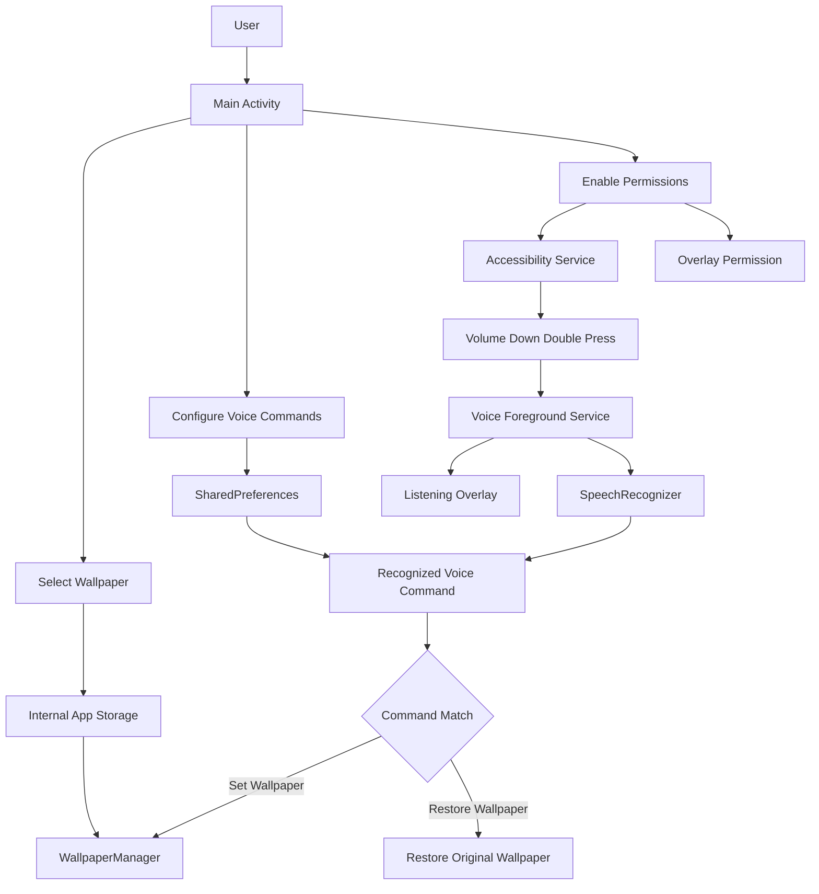

# 🎨 DG Themes – Voice Controlled Wallpaper Changer

<p align="center">
  <strong>Change Your Wallpaper With Just Your Voice</strong>
</p>

<p align="center">
  An innovative Android application that allows users to change and restore their device wallpaper using customizable voice commands triggered by a double press of the volume-down button.
</p>

<p align="center">
  
  
  
  
</p>

---

## 📌 Table of Contents

1. [Introduction](#-introduction)
2. [Project Overview](#-project-overview)
3. [Project Objectives](#-project-objectives)
4. [Key Features](#-key-features)
5. [Technology Stack](#-technology-stack)
6. [System Architecture](#-system-architecture)
7. [Project Structure](#-project-structure)
8. [Application Workflow](#-application-workflow)
9. [Main Application](#-main-application)
10. [Volume Button Detection](#-volume-button-detection)
11. [Voice Recognition](#-voice-recognition)
12. [Wallpaper Management](#-wallpaper-management)
13. [Floating Listening Overlay](#-floating-listening-overlay)
14. [Permission Management](#-permission-management)
15. [Local Data Storage](#-local-data-storage)
16. [Installation and Setup](#-installation-and-setup)
17. [Build Configuration](#-build-configuration)
18. [Testing](#-testing)
19. [Security and Privacy](#-security-and-privacy)
20. [Current Implementation Status](#-current-implementation-status)
21. [Future Enhancements](#-future-enhancements)
22. [Contributing](#-contributing)
23. [License](#-license)
24. [Repository](#-repository)

---

## 🎯 Introduction

**DG Themes** is an innovative Android wallpaper customization application designed to provide a convenient, hands-free way of changing device wallpapers.

Traditional wallpaper-changing applications require users to open an application, navigate through settings or galleries, select an image and manually apply it.

DG Themes introduces an alternative approach using voice commands and hardware button interaction.

The application allows users to select a custom wallpaper, configure their preferred voice keywords and trigger speech recognition using a double press of the volume-down button.

Once a configured command is recognized, the application automatically applies the selected wallpaper or restores the previously captured wallpaper.

The project combines Android accessibility functionality, speech recognition, background services and native wallpaper management.

---

## 🚀 Project Overview

DG Themes is developed as a native Android application using Kotlin.

The application consists of three major components:

1. Main Android Activity.
2. Accessibility Service.
3. Voice Foreground Service.

These components work together to provide volume-button detection, voice-command processing and wallpaper customization.

### Project Vision

To create a simple and intelligent Android customization experience that allows users to control their device wallpaper without navigating through multiple application screens.

### Target Users

- Android smartphone users.
- Users interested in personalized wallpapers.
- Users looking for hands-free smartphone interaction.
- Users interested in voice-controlled mobile applications.
- Users interested in Android accessibility-based functionality.

---

## 🎯 Project Objectives

- Develop a native Android wallpaper-changing application.
- Allow users to select custom images from their device gallery.
- Detect volume-down button double presses.
- Integrate Android speech recognition.
- Provide customizable voice commands.
- Apply wallpapers through Android WallpaperManager.
- Restore the previously captured wallpaper during the active service session.
- Display a floating listening interface.
- Maintain service functionality using an Android foreground service.
- Store user preferences locally.

---

## ✨ Key Features

### 1. Custom Wallpaper Selection

Users can select their preferred image from the device gallery.

Features include:

- Open the device image picker.
- Select a custom photograph.
- Copy the selected image to internal application storage.
- Save the image location locally.
- Reuse the selected image when a voice command is recognized.

### 2. Volume Button Double Press

The application uses Android Accessibility Service to detect volume-down button events.

The detection logic identifies two consecutive presses within a 500-millisecond interval.

When a valid double press is detected:

- An event is generated.
- The voice foreground service receives a listening request.
- The voice recognition interface is displayed.
- Speech recognition begins.

### 3. Customizable Voice Commands

Users can configure their preferred wake-up and exit keywords.

Default commands:

| Command | Action |
|---|---|
| Set Wallpaper | Apply the selected wallpaper |
| Restore Wallpaper | Restore the previously captured wallpaper |

Users can change these keywords through the main application interface.

The configured words are saved in SharedPreferences.

### 4. Voice Recognition

The application integrates Android SpeechRecognizer.

Features include:

- Speech recognition availability checking.
- Free-form speech recognition.
- Partial-results configuration.
- Recognition result processing.
- Keyword matching.
- Voice-command execution.

### 5. Automatic Wallpaper Changing

When the wake-up keyword is recognized, the application uses Android WallpaperManager to apply the selected image.

The original wallpaper is captured before the new wallpaper is applied, provided it can be retrieved.

### 6. Wallpaper Restoration

When the configured exit keyword is recognized, the application attempts to restore the previously captured wallpaper.

The original wallpaper is maintained as a Bitmap in the active foreground service.

### 7. Floating Listening Overlay

A floating interface is displayed during voice recognition.

It uses Android WindowManager to display an overlay above other applications.

The overlay is removed after speech recognition completes or encounters an error.

### 8. Foreground Service

The application uses an Android foreground service to manage voice recognition.

Features include:

- Persistent service notification.
- Notification channel creation.
- Voice recognition management.
- Service lifecycle handling.
- Listening action handling.

---

## 🛠️ Technology Stack

| Technology | Purpose |
|---|---|
| Kotlin | Application programming language |
| Android SDK | Native Android development |
| Android Studio | Development environment |
| Android Accessibility Service | Hardware button event detection |
| SpeechRecognizer | Speech-to-text functionality |
| WallpaperManager | Wallpaper application and restoration |
| SharedPreferences | Local configuration storage |
| WindowManager | Floating overlay management |
| Foreground Service | Background service execution |
| AndroidX Core KTX | Android utility functionality |
| AndroidX AppCompat | Backward-compatible UI components |
| Material Components | UI elements |
| Gradle Kotlin DSL | Build and dependency configuration |

---

## 🏗️ System Architecture

The application follows a service-based Android architecture.

### High-Level Architecture



### Architecture Components

**1. Main Activity**

Provides the user interface for selecting wallpapers, configuring voice keywords and enabling required Android permissions.

**2. Accessibility Service**

Monitors volume-down key events and detects double presses.

**3. Voice Foreground Service**

Handles voice recognition, command processing, wallpaper operations and floating overlay management.

**4. SharedPreferences**

Stores the selected wallpaper path and customized voice commands.

**5. Android System Services**

Provides native speech recognition, wallpaper management and overlay functionality.

---

## 📁 Project Structure

```text
DG_Themes/
│
├── .idea/
│   └── Android Studio project settings
│
├── app/
│   │
│   ├── src/
│   │   ├── main/
│   │   │   │
│   │   │   ├── java/
│   │   │   │   └── com/
│   │   │   │       └── example/
│   │   │   │           └── dgtheme/
│   │   │   │               ├── MainActivity.kt
│   │   │   │               ├── MyAccessibilityService.kt
│   │   │   │               └── VoiceForegroundService.kt
│   │   │   │
│   │   │   ├── res/
│   │   │   │   ├── layout/
│   │   │   │   ├── values/
│   │   │   │   ├── drawable/
│   │   │   │   ├── mipmap/
│   │   │   │   └── xml/
│   │   │   │
│   │   │   └── AndroidManifest.xml
│   │   │
│   │   └── test/
│   │       └── Unit and instrumentation tests
│   │
│   ├── build.gradle.kts
│   └── proguard-rules.pro
│
├── gradle/
│   └── libs.versions.toml
│
├── build.gradle.kts
├── gradle.properties
├── gradlew
├── gradlew.bat
├── settings.gradle.kts
└── README.md
```

---

## 📱 Main Application

**File:** `MainActivity.kt`

The MainActivity is the primary user interface of the application.

### Responsibilities

- Initialize application preferences.
- Load saved voice keywords.
- Select wallpaper images.
- Copy images to internal storage.
- Save selected wallpaper paths.
- Open Android Accessibility Settings.
- Request overlay permissions.
- Request microphone permissions.
- Request image access permissions.
- Start the voice foreground service.
- Update permission-related button states.

### Wallpaper Selection

The application uses Android's Activity Result API to launch the image picker.

After an image is selected:

1. The selected image URI is received.
2. The image is opened using ContentResolver.
3. The image is copied into internal application storage.
4. Its local file path is saved in SharedPreferences.
5. A confirmation message is displayed.

### Preference Storage

The application uses a SharedPreferences file named:

`DGThemePrefs`

Stored values include:

| Key | Purpose |
|---|---|
| `wallpaper_path` | Selected wallpaper file path |
| `wakeup_word` | Wallpaper activation keyword |
| `exit_word` | Wallpaper restoration keyword |

---

## 🔘 Volume Button Detection

**File:** `MyAccessibilityService.kt`

The application uses Android Accessibility Service to monitor key events.

### Double Press Detection

The application tracks the time of the last volume-down press.

Configured interval:

`500 milliseconds`

### Detection Workflow

```text
Volume Down Press
        |
        v
Store Current Timestamp
        |
        v
Second Volume Down Press
        |
        v
Calculate Time Difference
        |
        v
Is Difference Less Than 500ms?
        |
      Yes
        |
        v
Trigger Voice Listening
        |
        v
Start Foreground Service
```

### Main Responsibilities

- Receive Android accessibility key events.
- Identify volume-down key presses.
- Calculate the interval between presses.
- Detect double presses.
- Send a listening action to the voice foreground service.

The service requests key-event filtering through Android Accessibility Service configuration.

---

## 🎙️ Voice Recognition

**File:** `VoiceForegroundService.kt`

The voice foreground service manages the application's speech recognition workflow.

It uses Android SpeechRecognizer to convert spoken commands into text.

### Voice Recognition Workflow

1. Receive a listening request.
2. Display the floating listening interface.
3. Check speech recognition availability.
4. Create a SpeechRecognizer instance.
5. Configure free-form speech recognition.
6. Start listening.
7. Receive recognition results.
8. Convert recognized text to lowercase.
9. Compare the text with saved keywords.
10. Execute the appropriate wallpaper operation.
11. Hide the listening overlay.

### Default Voice Commands

**Activation command:**

`set wallpaper`

Action: Applies the selected custom wallpaper.

**Restoration command:**

`restore wallpaper`

Action: Attempts to restore the previously captured wallpaper.

### Custom Commands

Users can modify both commands in the MainActivity.

The updated keywords are saved locally and loaded by the voice service.

---

## 🖼️ Wallpaper Management

The application uses Android's native WallpaperManager API.

### Applying a Wallpaper

When the activation keyword is recognized:

1. Obtain the WallpaperManager instance.
2. Capture the current wallpaper if no original image has been saved in the service.
3. Read the selected wallpaper path.
4. Decode the image into a Bitmap.
5. Apply the image using WallpaperManager.

### Restoring a Wallpaper

When the restoration keyword is recognized:

1. Check whether the original wallpaper Bitmap is available.
2. Retrieve the saved Bitmap.
3. Apply it through WallpaperManager.
4. Log the result.

**Important:** The original wallpaper Bitmap is maintained in service memory. It is not permanently saved, so restoration may not work after the service is destroyed or the device restarts.

---

## 🔊 Floating Listening Overlay

The application uses Android WindowManager to display a floating listening interface.

### Overlay Functionality

- Inflate the listening overlay layout.
- Create overlay window parameters.
- Use the appropriate Android window type.
- Display the overlay at the centre of the screen.
- Remove the overlay after speech recognition completes.
- Handle overlay-related exceptions.

The application requires the user to grant permission to display over other apps.

---

## 🔐 Permission Management

The Android Manifest declares the following permissions and service components.

| Permission / Component | Purpose |
|---|---|
| `SYSTEM_ALERT_WINDOW` | Display floating overlay |
| `FOREGROUND_SERVICE` | Run foreground service |
| `RECORD_AUDIO` | Access microphone |
| `SET_WALLPAPER` | Set device wallpaper |
| `FOREGROUND_SERVICE_MICROPHONE` | Microphone foreground service type |
| `POST_NOTIFICATIONS` | Display service notifications |
| `READ_MEDIA_IMAGES` | Access images on Android 13+ |
| `READ_EXTERNAL_STORAGE` | Legacy image access on Android 12 and below |
| Accessibility Service | Detect hardware key events |

### Required User Setup

Before using all features:

1. Open the application.
2. Enable the Accessibility Service.
3. Grant display-over-other-apps permission.
4. Grant microphone permission.
5. Grant image access permission when requested.
6. Select a wallpaper.
7. Start the voice foreground service.

Some permissions require manual approval through Android Settings.

---

## 💾 Local Data Storage

The application uses internal storage and SharedPreferences.

### Internal Storage

The selected wallpaper is copied to the application's private internal storage.

Example filename:

`selected_wallpaper.jpg`

### SharedPreferences

The following information is stored locally:

- Wallpaper file path.
- Wake-up keyword.
- Exit keyword.

No external database or cloud backend is currently required.

---

## 💻 Installation and Setup

### Prerequisites

Install the following:

- Android Studio.
- Android SDK.
- JDK compatible with the Android Gradle Plugin.
- Git.
- Android device or emulator.

### Step 1: Clone the Repository

```bash
git clone https://github.com/gandha-24/DG_Themes.git
```

### Step 2: Open the Project

Open Android Studio.

Select:

`File → Open`

Choose the cloned `DG_Themes` project folder.

### Step 3: Sync Gradle

Allow Android Studio to synchronize the Gradle project and download the required dependencies.

### Step 4: Connect an Android Device

Enable Developer Options and USB Debugging on your Android phone.

Connect the phone using USB.

Alternatively, use an Android emulator.

### Step 5: Run the Application

Select the application run configuration and click the Run button in Android Studio.

The application will be installed on the connected device.

---

## ⚙️ Build Configuration

The application uses Gradle Kotlin DSL.

### Application Configuration

| Setting | Value |
|---|---|
| Project Name | DG Theme |
| Application ID | `com.example.dgtheme` |
| Namespace | `com.example.dgtheme` |
| Programming Language | Kotlin |
| Compile SDK | 36 |
| Minimum SDK | 24 |
| Target SDK | 36 |
| Android Gradle Plugin | 8.13.1 |
| Kotlin Version | 2.0.21 |
| Java Compatibility | 1.8 |
| Kotlin JVM Target | 1.8 |

### Dependencies

The project includes:

- AndroidX Core KTX.
- AndroidX AppCompat.
- Google Material Components.
- JUnit.
- AndroidX JUnit.
- Espresso.

Dependency versions are managed through:

`gradle/libs.versions.toml`

---

## 🧪 Testing

The application should be tested on supported Android devices.

### Functional Testing

| Test Case | Expected Result |
|---|---|
| Launch application | Main screen opens |
| Select wallpaper | Image is saved locally |
| Save custom keywords | Keywords are stored |
| Enable Accessibility Service | Service becomes available |
| Grant overlay permission | Overlay permission is enabled |
| Double press volume down | Voice listening is triggered |
| Speak activation keyword | Selected wallpaper is applied |
| Speak restoration keyword | Original wallpaper is restored when available |
| Deny microphone permission | Voice recognition cannot start |
| Speech recognition error | Listening overlay is removed |

### Device Compatibility

Test on different Android versions because accessibility services, foreground services, microphone restrictions and image permissions can vary across Android releases.

---

## 🔒 Security and Privacy

DG Themes uses device permissions to provide its functionality.

Recommended privacy practices:

1. Explain why microphone permission is required.
2. Request accessibility permission only for volume-button detection.
3. Explain why overlay permission is required.
4. Avoid collecting or transmitting voice recordings unnecessarily.
5. Keep user-selected images in private application storage.
6. Avoid exposing personal image paths.
7. Handle speech-recognition errors safely.
8. Provide clear controls to stop the foreground service.

Voice recognition availability and processing may depend on the Android device's installed speech-recognition provider and configuration.

---

## 📊 Current Implementation Status

| Feature | Status |
|---|---|
| Native Android application | Implemented |
| Wallpaper image selection | Implemented |
| Internal image storage | Implemented |
| Custom voice keywords | Implemented |
| SharedPreferences | Implemented |
| Accessibility Service | Implemented |
| Volume-down double press | Implemented |
| Voice foreground service | Implemented |
| Speech recognition | Implemented |
| Floating listening overlay | Implemented |
| Wallpaper application | Implemented |
| Original wallpaper restoration | Session-based implementation |
| Cloud wallpaper synchronization | Not implemented |
| Multiple wallpaper collections | Not implemented |
| Continuous background wake-word detection | Not implemented |

---

## 🔮 Future Enhancements

Potential improvements include:

### 1. Multiple Wallpaper Collections

- Save multiple wallpapers.
- Create custom wallpaper collections.
- Switch between selected images.
- Random wallpaper selection.

### 2. Advanced Voice Commands

- Support multiple languages.
- Improve keyword matching.
- Support additional customization commands.
- Add offline speech recognition where supported.

### 3. Improved Wallpaper Restoration

- Persist the original wallpaper before changing it.
- Improve restoration across service restarts.
- Handle lock-screen and home-screen wallpaper options separately.

### 4. Advanced Hardware Controls

- Support configurable hardware button shortcuts.
- Add alternative gesture triggers.
- Allow users to select their preferred trigger.

### 5. User Interface Improvements

- Modern Material Design interface.
- Wallpaper previews.
- Theme customization.
- Animated listening indicators.
- Better permission setup guidance.

### 6. Privacy Improvements

- Clear microphone usage indicators.
- Explicit service controls.
- Transparent accessibility permission explanations.
- Improved local data management.

---

## 🤝 Contributing

Contributions, bug reports and feature suggestions are welcome.

### Contribution Steps

1. Fork the repository.
2. Create a feature branch.
3. Implement the required changes.
4. Test on an Android device.
5. Commit your changes.
6. Push the branch.
7. Create a Pull Request.

Example:

```bash
git checkout -b feature/new-feature

git add .

git commit -m "Add new feature"

git push origin feature/new-feature
```

---

## 📄 License

No LICENSE file was identified in the repository.

Please confirm the licensing terms with the repository owner before redistributing or reusing this project.

---

## 🔗 Repository

**Project Name:** DG Themes

**Platform:** Android

**Programming Language:** Kotlin

**Repository:**

https://github.com/gandha-24/DG_Themes

**Default Branch:** `master`

---

<p align="center">
  <strong>DG Themes</strong>
  <br/>
  Your Wallpaper. Your Voice. Your Style.
  <br/><br/>
  Developed with Kotlin and Android Studio.
</p>
